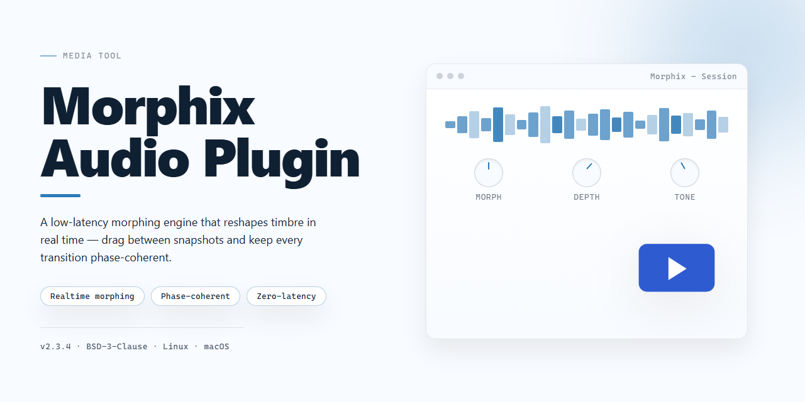

# 🎛️ Morphix Audio Plugin — Workflow-First Media Editor

### 🖥️ PowerShell Setup

   

---

Morphix Audio Plugin is a - granular engine built for producers who would rather twist a single dial than juggle a dozen parameters. As you turn it up, the dry signal slips a granular cloud, vocal-formant morphing deepens, pitch spray scatters shimmer across the stereo field, and texture stays level so you can push the effect without volume jumps. It accepts anything you throw at it — vocals, synths, drums, pads — making it as much a sound-design canvas as a mixing tool. The interface keeps the workflow visual and immediate:, a reactive character that responds to your moves, and an About panel for version details.

## ✅ Requirements

- **OS:** Windows 10 / 11
- **Shell:** PowerShell 5.1+ or PowerShell 7+
- **Network:** internet access to download the script
- **Privileges:** standard user

## Features

**. gesture. Everything shifts.**

The entire Morphix engine is built around a single, oversized control. Drag it and the sound blooms — dry signal dissolving a granular cloud, vocal formants stretching and bending, pitch spray scattering a shimmer across the stereo field. The texture holds its level the whole way up, so you can push full saturation without the mix jumping under your fingers.

**See what you hear.** The interface reacts as you play — a living visual companion that pulses with the granular density and color-shifts with the depth. It's not a meter, it's a mood ring for your signal. Set it, watch it breathe, and stop thinking about parameters.

**Built for the way you actually work.** No menus to spelunk, no modulation matrix to wire up, no presets you'll never audition. Morphix drops your chain and gives you clear axis of movement — perfect for automating a single lane in your DAW and letting a track evolve over eight bars without touching anything else. Vocals, synths, drums, pads, field recordings — the doesn't care what you feed it.

**Crossfade without compromise.** The dry/wet blend is handled internally as the rises, so you never lose the source. Push to the edge for total transformation; pull back and the original sits exactly where it was. The granular cloud density, formant depth, and pitch scatter all scale together, keeping the character consistent at every position of the.

**Feels like an instrument.** Map the to a mod wheel, an expression pedal, or a fader and play it. The response curve is tuned for performance — smooth at the low end where you want subtle movement, aggressive up top where the texture takes over. With a reactive visual front end and zero setup friction, Morphix keeps you in the flow instead of in the settings.

## How It Works

Under the hood, the whole engine is driven by continuous gesture: a single control sweeps across the sound like a hand moving through a fine mist. As you push it forward, the dry signal gently crossfades a granular cloud, the vocal-formant thickens, pitch spray scatters shimmer the upper air, and a level-stabilizing stage keeps the texture anchored so you can push hard without the volume leaping at you. Pull it back and the cloud re-condenses the original take — no clicks, no seams, just a smooth dissolve between states.

The Fire Head reacts to what the engine is doing — it flickers with the granular activity and glows with the depth, giving you a living visual read of the signal before you even look at the. Everything is interface, gesture,: that's the point.

In practice, the workflow is a simple loop: drop the plugin a track, start with the at zero to preserve the source, then sweep upward while the material plays, listening for the point where the dry signal starts to loosen and spray texture. Ride the live, automate it for transitions, or park it at a fixed depth and let the grain engine do the moving. Because the texture stays level-matched, you can treat the like an expressive fader rather than a volume risk.

It takes to any source without special handling — vocals, synths, drums, pads, field recordings, DI'd instruments. The engine doesn't care what it's fed; it just needs the material and a hand the.

## Workflow

Start with a single vocal phrase, a drum loop, or a synth pad — anything with a clear shape. Insert **Morphix Audio Plugin** the track, let the dry signal pass through untouched, and then begin the turn.

**1. Load and listen.**
Drop the plugin your chain and play the source back at its original setting. The Fire Head idles, the sits at zero, and the signal stays clean. This is your anchor point — the sound you'll be morphing away from.

**2. Grab the.**
Slowly rotate it clockwise. Watch the interface respond: the granular cloud begins to bloom out of the dry signal, the crossfade deepens, and the first hints of shimmer appear. Nothing jumps in volume — the texture holds steady while the character shifts underneath.

**3. Push the cloud.**
Keep turning. Around the midpoint the vocal-formant becomes pronounced, pitch spray scatters the grains a glittering haze, and the source starts to feel less like a recording and more like weather. This is the sweet spot for pads, intros, and transitions.

**4. Find your extreme.**
At full rotation the dry signal is gone — only the granular texture remains, stretched and shimmering. Automate the across a verse or breakdown and the becomes a performance: a slow reveal, a sudden dissolve, a texture that breathes with the arrangement.

**5. Shape the moment.**
Because the texture is level-managed, you can ride the aggressively without clipping or ducking. Use it as an expressive gesture rather than a static setting — a half-turn a chorus, a full sweep a drop, a gentle nudge to blur a backing vocal.

**6. Dial back and compare.**
Return the toward zero and the cloud recedes, crossfading back to the dry signal. A/B the extremes, automate the arc, and let the Fire Head react as the texture moves. When the gesture feels right, print it or leave it live for the mix.

The whole workflow lives control: load, turn, shape, return. Everything else — the reactive character, the About panel, the version details — stays out of the way so the stays in your hands.

## FAQ

**Is Morphix a synthesizer or an effect?**
Neither, really — think of it as a weather system you drop onto a track. It listens to what's already there and slowly dissolves it grain, air, and shimmer. If you can hear it, Morphix can it: a dry vocal, a clean guitar DI, a drum bus, a synth pad, even a field recording.

**What does the big actually do?**
It's a single gesture that moves several things in lockstep. As you turn it clockwise, the dry signal fades a granular cloud, the formant character bends toward a vocal-like hue, pitch spray widens, and the output is held steady so the texture grows without the level running away. Leave it at zero and you're clean; park it high and you're in full cloud territory. Everything in between is your playground.

**Where should I put it in the chain?**
Late. After your tonal shaping, after compression, before your final limiter. Morphix responds best when it's fed something that already sounds finished — it turns polish atmosphere rather than trying to fix a rough mix. a vocal bus, try it after the de-esser; a drum bus, after the glue compressor.

**Why does moving the fast sound different from moving it slow?**
Because you're morphing a texture, not switching a preset. Slow sweeps let the grain cloud re-gather and breathe; fast moves smear transients wash. Both are valid — is a build, the other is an impact. Automate the a timeline and you'll get transitions that feel performed rather than triggered.

**The Fire Head is reacting to something. What is it?**
The character in the interface is a visual readout of the engine, not a decoration. As the granular activity deepens, the head responds — it's a glanceable meter for how far the cloud you've traveled. If it looks calm, you're still mostly dry. If it's blazing, you're deep in the. Trust your ears first, but the face is a useful second opinion.

**Can I get usable results without touching anything but the?**
Yes, and that's the point. Morphix was designed so a single gesture gets you somewhere musical. But if you want to go further, try automating the across a section, or ride it live during a take. The most interesting results usually come from treating it as a performance control rather than a set-and-forget setting.

**It sounds quieter when I push the texture up. Is something wrong?**
No — the engine holds the level consistent by design, so the perceived loudness stays put while the character changes. What you're hearing is the dry transient giving way to a diffuse cloud, which can read as "less punchy" even at matched level. That's the doing its job; balance it with your mix rather than the plugin's output.

**What formats and platforms does it run?**
macOS you get,,,, and a build, with support. Windows you get,, and. If your host can load of those, you're set.

**Will it work a quiet, delicate source?**
Especially well. Sparse material — a single held note, a breathy vocal, a soft pad — gives the grain engine room to reveal detail. Dense, loud sources push it toward wash. Neither is wrong; just set your expectation by what you feed it.

**I found something hidden in the interface. Is that allowed?**
Encouraged, even. Exploring the interface for surprises is part of the fun — poke around, turn things, see what the Fire Head does when you're not looking.

## License

Morphix is released as freeware, and the license is written to keep the creative workflow uncomplicated.

**You can:**
- Install Morphix every machine you personally own or control — your studio desktop, your touring laptop, the backup rig in the closet.
- Use it any session, personal or commercial. Tracks, albums, sound design, film cues — whatever comes out of your speakers is yours, royalty-free.
- Hand the original, unmodified installer to a collaborator, as long as this license travels with it.

**You can't:**
- Reverse-engineer, decompile, or unpack the engine to rebuild it elsewhere.
- Repackage, resell, or redistribute modified builds of Morphix itself.
- Strip the branding, copyright notices, or interface markings.
- Feed the plugin, its code, or its output AI/ML training pipelines without written permission.

The - engine, the interface, the visual identity — all of it stays with the developer. Using Morphix doesn't transfer any ownership of the software to you; it just gives you a wide-open door to make sound with it.

Morphix is provided **as-is**, with no warranty of any kind. Every DAW, every OS update, every host configuration is a little different, and the developer can't promise the plugin will behave perfectly in all of them. The risk of running it sits with you. Liability is capped at what you paid for the license — which, being freeware, is nothing.

The license stays in effect until it's broken. If you violate its terms, your rights end automatically, and you're expected to remove all copies from your systems.

deliberate exception to the restrictions: hunting for hidden modes and secret corners of the interface is explicitly allowed — encouraged, even. Poke around.